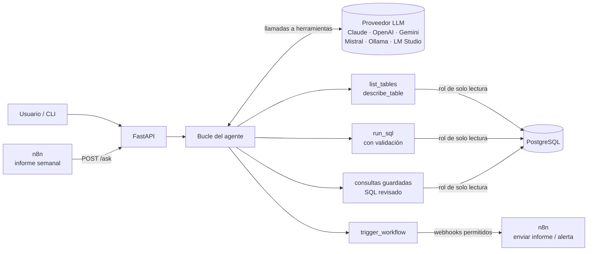
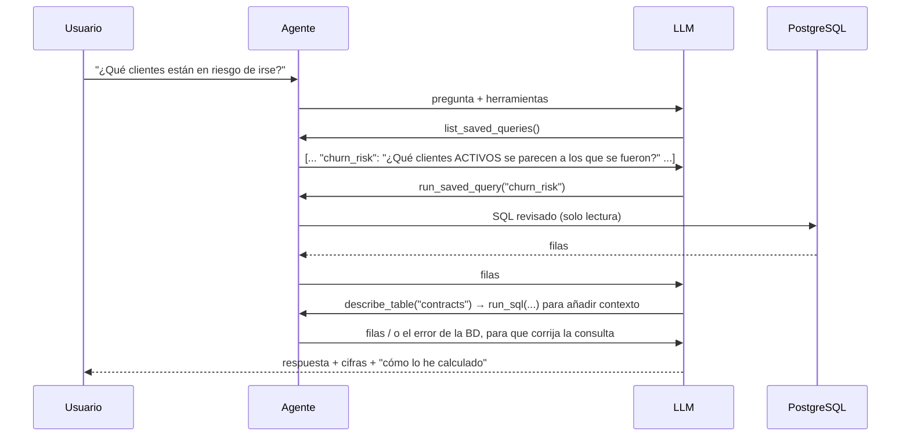

# Agentic Data Assistant

🇬🇧 [Read in English](README.md)

[](https://github.com/marc-tutusaus/agentic-data-assistant/actions/workflows/ci.yml)


**Un agente de IA que responde preguntas de negocio a partir de una base de datos SQL.** Le preguntas en lenguaje natural, por ejemplo *"¿Qué clientes activos están en riesgo de irse, y por qué?"*, y el agente hace el trabajo él solo:

1. Explora el modelo de datos.
2. Escribe y ejecuta SQL de solo lectura.
3. Si una consulta falla, la corrige.
4. Responde con las cifras y explica cómo las ha calculado.

Además puede **lanzar workflows de n8n** (enviar un informe, generar una alerta), y **n8n puede llamarlo** de forma programada.

Funciona con **cualquier proveedor de LLM**: Claude, OpenAI, Gemini, Mistral, o modelos locales con Ollama o LM Studio. Se cambia con un único ajuste.

### Ejecución real

`data-agent ask "Since we upgraded the AI triage model, are tickets routed to the right team more often? Is it worth the extra cost?"` con **gpt-5.6-luna**: 7 llamadas a herramientas, 22 s, **0,005 $**.


*Exportado con `--save-svg` desde la salida real de la terminal. En pantalla el SQL aparece recortado; `--json` y la API lo devuelven completo.*

## Arquitectura



### Cómo responde el agente a una pregunta



## Pensado para producción

| Riesgo | Cómo se resuelve |
|---|---|
| **El LLM escribe SQL incorrecto o peligroso** | Tres capas independientes. **(1)** Un rol de PostgreSQL que solo puede hacer `SELECT`, con transacciones de solo lectura y un `statement_timeout` de 5 s. **(2)** Un validador de SQL basado en un parser real (`sqlglot`) que rechaza varias sentencias a la vez, DML escondido dentro de CTEs, `SELECT INTO`, bloqueos de filas, funciones peligrosas (`pg_sleep`, `pg_read_file`, `query_to_xml`…) y tablas de sistema. **(3)** Un `LIMIT` exterior en todas las consultas. Los [tests](tests/test_agent.py) comprueban que, si el modelo pide un `DELETE`, los datos quedan intactos. |
| **Columnas o reglas de negocio inventadas** | Cada tabla y columna tiene un `COMMENT` en SQL que `describe_table` devuelve. Así el modelo lee, por ejemplo, que `end_date IS NULL` significa "contrato activo" en lugar de suponerlo. Además se le ofrecen primero las **consultas guardadas**, que ya están revisadas. |
| **Errores** | Los errores de la base de datos y del validador vuelven al modelo como errores de herramienta, y él mismo corrige su consulta. Los argumentos con JSON inválido se tratan igual. |
| **Bucles sin fin y coste** | Un límite de pasos obliga a terminar con una respuesta final a partir de los datos ya obtenidos. Se registran los tokens y el coste de cada pregunta. Con Claude se usa prompt caching para el prompt de sistema y las definiciones de herramientas, que se repiten en cada paso. |
| **Dependencia de un proveedor** | El bucle del agente usa tipos neutrales. Tres adaptadores cubren seis proveedores: [Anthropic](src/data_agent/llm/anthropic_client.py) (Messages API, con fallback en el servidor si el modelo rechaza la petición), [OpenAI](src/data_agent/llm/openai_responses.py) (Responses API, necesaria para usar razonamiento y herramientas a la vez en GPT-5.x) y [compatible con OpenAI](src/data_agent/llm/openai_compat.py) (Gemini, Mistral, Ollama, LM Studio). |
| **Acciones en otros sistemas** | `trigger_workflow` solo puede llamar a webhooks de n8n **de una lista permitida**, y solo cuando el usuario lo pide expresamente. |
| **Observabilidad** | Cada paso queda trazado (herramienta, argumentos, SQL, duración, error) y la API lo devuelve. |

## Lección de una ejecución real: corrige la documentación de los datos, no el prompt

Ante la pregunta *"¿Qué sector deja más horas facturables sin facturar?"*, el agente (gpt-5.6-luna) exploró el esquema, escribió su propio SQL y respondió **104,7 h**. Lo comprobé con mi propia consulta: el SQL era correcto, pero la cifra incluía el **mes en curso**, que por diseño no se factura hasta principios del mes siguiente.

La causa era el comentario de la columna. `invoice_id` decía *"NULL + facturable = ingreso aún no facturado"*, y eso es ambiguo. Reescribí ese `COMMENT` con la regla de negocio exacta: la fuga de facturación solo cuenta meses ya cerrados. En la siguiente ejecución el agente aplicó la regla, respondió **84,2 h** (la cifra correcta) y citó la regla en su explicación. No hizo falta tocar el prompt.

**Conclusión:** cuando un agente trabaja sobre datos, la documentación del esquema forma parte del producto. Un comentario preciso corrige todas las consultas futuras que usen esa columna.

### Segunda lección: no dejes que el modelo haga cuentas

En una primera ejecución de la pregunta del ejemplo de arriba, la tabla de cifras era correcta, porque venía de SQL. Pero después el modelo calculó por su cuenta el punto de equilibrio y le salió **15,60 $** en lugar de **0,0156 $**: se equivocó por un factor de 1.000. Añadí una regla al prompt de sistema: *las cifras derivadas (diferencias, ratios, coste por unidad, punto de equilibrio) también deben calcularse con `run_sql`*. En la siguiente ejecución lo calculó con SQL y acertó (0,0154 $ con los datos actuales). Las cuentas las hace SQL y el LLM solo las explica.

## Puesta en marcha

### Opción A: Docker (Postgres + API + n8n)

```bash
cp .env.example .env     # define LLM_PROVIDER, su clave de API y las contraseñas
docker compose up -d --build
curl -X POST localhost:8000/ask -H "Content-Type: application/json" \
     -d '{"question": "¿Qué equipo tiene el peor tiempo de primera respuesta este trimestre?"}'
```

n8n queda disponible en http://localhost:5678 con los workflows de [`n8n/`](n8n) ya importados.

### Opción B: sin Docker

```bash
python -m venv .venv && .venv/Scripts/activate    # Linux/macOS: source .venv/bin/activate
pip install -e ".[dev]"
data-agent dev-db          # arranca un PostgreSQL local con los datos de demo y muestra AGENT_DATABASE_URL
cp .env.example .env       # pega AGENT_DATABASE_URL y define LLM_PROVIDER y su clave
data-agent ask "¿Cuánto trabajo facturable no hemos facturado nunca, y de qué clientes?"
```

> 💡 ¿Sin clave de pago? `LLM_PROVIDER=gemini` funciona con una clave gratuita de Google AI Studio.

### Preguntas para probar

- *¿Estamos cumpliendo el SLA con los clientes premium? Muestra la tendencia de los últimos 6 meses.*
- *Desde que cambiamos el modelo de triaje, ¿se enrutan mejor los tickets? ¿Compensa el coste?*
- *¿El agente de voz con IA está quitando carga a la línea telefónica?*
- *¿Qué clientes no son rentables una vez contamos el tiempo de soporte?*
- *Envía al equipo un informe del backlog con más de 14 días.* (lanza n8n)

## API

`POST /ask` (con token Bearer cuando `API_TOKEN` está definido)

```json
{ "question": "¿Qué clientes nos deben dinero desde hace más de 90 días?", "provider": "anthropic" }
```

La respuesta incluye la contestación y la traza completa:

```json
{
  "answer": "…",
  "stop": "answered",
  "steps": [{ "step": 1, "tool": "run_saved_query", "ok": true, "duration_ms": 41, "detail": { "saved_query": "receivables_aging" } }],
  "sql": ["SELECT …"],
  "usage": { "input_tokens": 0, "output_tokens": 0, "cache_read_tokens": 0 },
  "provider": "anthropic", "model": "claude-opus-5-5", "cost_usd": 0.0, "duration_ms": 0
}
```

Documentación interactiva: http://localhost:8000/docs

## Integración con n8n

| Workflow | Dirección | Qué hace |
|---|---|---|
| [`weekly-ops-report`](n8n/weekly-ops-report.json) | n8n → agente | Cada lunes a las 08:00 le pide al agente el informe de operaciones (SLA, backlog, riesgo de abandono, trabajo sin facturar), lo convierte a HTML y lo envía por email. Si el agente no termina, envía en su lugar un email de aviso. |
| [`agent-send-report`](n8n/agent-send-report.json) | agente → n8n | Webhook detrás de `trigger_workflow("send_report")` |
| [`agent-raise-alert`](n8n/agent-raise-alert.json) | agente → n8n | Webhook detrás de `trigger_workflow("raise_alert")`, que enruta según la gravedad |

## Datos de demo

[`sql/`](sql) contiene una **empresa de servicios IT** ficticia: clientes, contratos, tickets de soporte, registros del triaje con IA, horas imputadas y facturas. Los datos se generan en SQL puro e incluyen patrones realistas para descubrir:

- señales de abandono de clientes
- trabajo sin facturar
- un agente de voz con IA que atiende cada vez más llamadas
- un cambio de modelo que mejoró la precisión del triaje

También incluye **10 consultas de análisis documentadas**. Más detalles en el [README de la capa de datos](sql/README.md) (en inglés).

## Estructura del proyecto

```
src/data_agent/
  llm/          tipos neutrales + adaptadores de Anthropic, OpenAI y compatibles con OpenAI
  agent/        bucle, herramientas, validador SQL, acceso de solo lectura a la BD, prompt de sistema
  api.py        FastAPI
  cli.py        data-agent ask | dev-db | serve
sql/            esquema, datos sintéticos, rol de solo lectura, consultas de análisis
n8n/            workflows que llaman al agente o a los que llama el agente
tests/          SQL, validador, adaptadores, bucle del agente, API (LLM simulado: sin claves de API)
```

## Tests

```bash
pytest          # usa TEST_DATABASE_URL o arranca automáticamente un PostgreSQL local
```

Los tests del agente usan un **LLM simulado** contra un PostgreSQL real, así que la CI es determinista y no necesita claves de API. Cubren:

- el bucle completo (explorar → SQL erróneo → error → SQL corregido → respuesta)
- el bloqueo de SQL destructivo
- el límite de pasos
- los rechazos del modelo
- los argumentos inválidos en las herramientas
- la lista de webhooks permitidos de n8n

---

© 2026 Marc Tutusaus Vilanova. Todos los derechos reservados. Ver [LICENSE](LICENSE).
