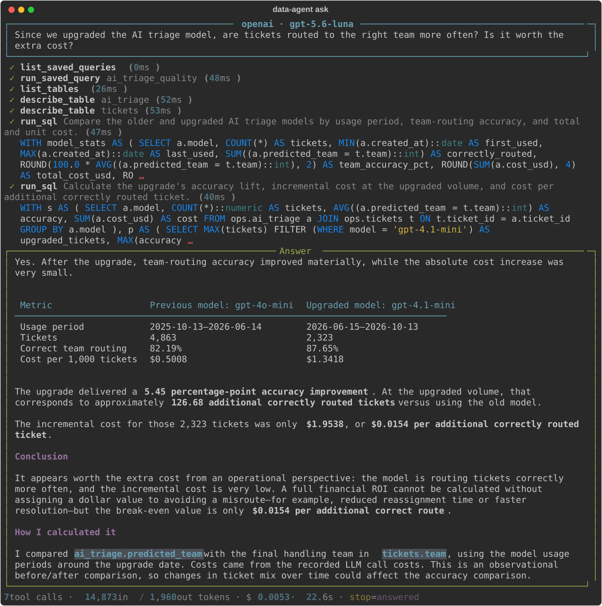
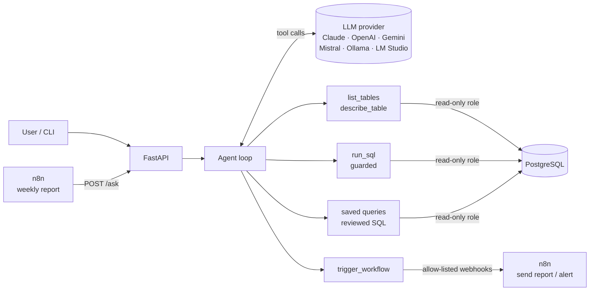
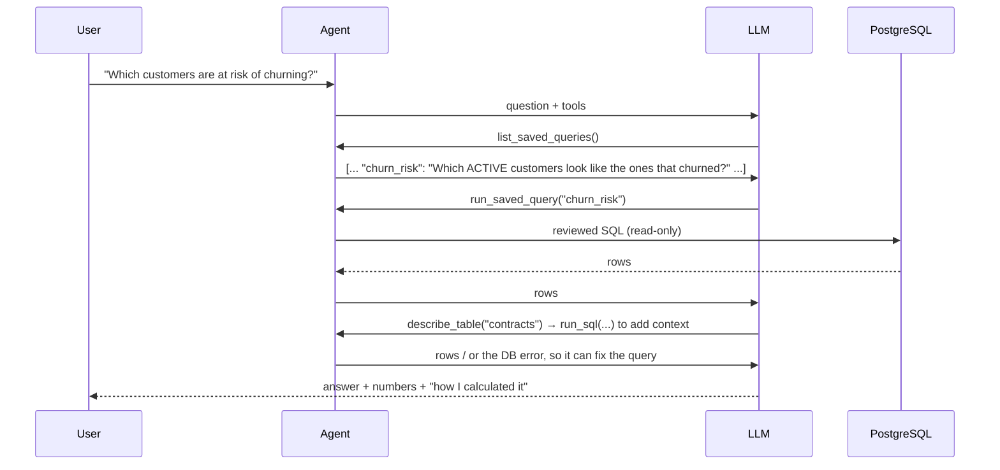

# Agentic Data Assistant

🇪🇸 [Leer en español](README.es.md)

[](https://github.com/marc-tutusaus/agentic-data-assistant/actions/workflows/ci.yml)


**An AI agent that answers business questions from a SQL database.** You ask in plain language, for example *"Which active customers are at risk of churning, and why?"*. The agent then works through the steps itself:

1. It explores the data model.
2. It writes and runs read-only SQL.
3. If a query fails, it fixes it.
4. It answers with the numbers and explains how it got them.

It can also **trigger n8n workflows** (send a report, raise an alert), and **n8n can call it** on a schedule.

It works with **any LLM provider**: Claude, OpenAI, Gemini, Mistral, or local models with Ollama or LM Studio. You choose with one setting.

### Real run

`data-agent ask "Since we upgraded the AI triage model, are tickets routed to the right team more often? Is it worth the extra cost?"` with **gpt-5.6-luna**: 7 tool calls, 22 s, **$0.005**.



*Exported with `--save-svg` from the actual terminal output. SQL is shortened on screen; `--json` and the API return it in full.*

## Architecture



### How the agent answers a question



## What makes it production-minded

| Concern | How it is handled |
|---|---|
| **The LLM writes bad or harmful SQL** | Three independent layers. **(1)** A PostgreSQL role with `SELECT` only, read-only transactions and a 5s `statement_timeout`. **(2)** A SQL validator built on a real parser (`sqlglot`) that rejects multiple statements, DML hidden in CTEs, `SELECT INTO`, row locks, dangerous functions (`pg_sleep`, `pg_read_file`, `query_to_xml`…) and system catalogs. **(3)** An outer `LIMIT` on every query. [Tests](tests/test_agent.py) check that a model asking for `DELETE` leaves the data untouched. |
| **Hallucinated columns or business rules** | Every table and column has a SQL `COMMENT` that `describe_table` returns, so the model reads that `end_date IS NULL` means active instead of guessing. Reviewed **saved queries** are offered first. |
| **Errors** | Database and validation errors go back to the model as tool errors, and it corrects its own query. Invalid tool-call JSON is handled the same way. |
| **Runaway loops and cost** | A step limit ends with a final answer from the data already collected. Tokens and cost are reported per question. Claude requests use prompt caching for the system prompt and tool definitions, which repeat on every step. |
| **Vendor lock-in** | The agent loop uses provider-neutral types. Three adapters cover six providers: [Anthropic](src/data_agent/llm/anthropic_client.py) (Messages API, server-side refusal fallback), [OpenAI](src/data_agent/llm/openai_responses.py) (Responses API, needed for GPT-5.x reasoning + tools) and [OpenAI-compatible](src/data_agent/llm/openai_compat.py) (Gemini, Mistral, Ollama, LM Studio). |
| **Actions in other systems** | `trigger_workflow` can only call **allow-listed** n8n webhooks, and only when the user explicitly asks. |
| **Observability** | Every step is traced (tool, arguments, SQL, duration, error) and returned by the API. |

## Lesson from a real run: fix the data documentation, not the prompt

Asked *"Which industry leaves the most billable hours unbilled?"*, the agent (gpt-5.6-luna) explored the schema, wrote its own SQL and answered **104.7 h**. I checked it with my own query: the SQL was correct, but the number included the **current month**, which by design is only invoiced at the start of next month.

The cause was the column comment: `invoice_id` said *"NULL + billable = revenue not yet invoiced"*, which is ambiguous. I rewrote that one `COMMENT` with the exact business rule (leakage counts only closed months). On the next run the agent applied the rule, answered **84.2 h** (correct), and cited the rule in its explanation. No prompt change was needed.

**Takeaway:** for agents working over data, schema documentation is part of the product. One precise comment fixes every future query that touches that column.

### Second lesson: never let the model do arithmetic

In an early run of the question above, the table of figures was right (it came from SQL), but the model then worked out a break-even point by itself and got **$15.60** instead of **$0.0156**: wrong by a factor of 1,000. I added one rule to the system prompt: *derived figures (differences, ratios, cost per unit, break-even points) must also be computed with `run_sql`*. The next run calculated it in SQL and got it right ($0.0154 with the current data). Plain SQL does the arithmetic and the LLM only explains it.

## Quickstart

### Option A: Docker (Postgres + API + n8n)

```bash
cp .env.example .env     # set LLM_PROVIDER, its API key and the passwords
docker compose up -d --build
curl -X POST localhost:8000/ask -H "Content-Type: application/json" \
     -d '{"question": "Which team has the worst first-response time this quarter?"}'
```

n8n runs at http://localhost:5678 with the workflows in [`n8n/`](n8n) already imported.

### Option B: no Docker

```bash
python -m venv .venv && .venv/Scripts/activate    # Linux/macOS: source .venv/bin/activate
pip install -e ".[dev]"
data-agent dev-db          # starts a local PostgreSQL with the demo data and prints AGENT_DATABASE_URL
cp .env.example .env       # paste AGENT_DATABASE_URL, set LLM_PROVIDER and its key
data-agent ask "How much billable work have we never invoiced, and for which customers?"
```

> 💡 No paid API key? `LLM_PROVIDER=gemini` works with a free Google AI Studio key.

### Questions to try

- *Are we meeting the SLA for premium customers? Show the trend for the last 6 months.*
- *Since we upgraded the triage model, are tickets routed better? Is it worth the cost?*
- *Is the AI phone agent reducing the load on the phone line?*
- *Which customers are unprofitable once support time is counted?*
- *Send the team a report on the backlog older than 14 days.* (triggers n8n)

## API

`POST /ask` (Bearer token when `API_TOKEN` is set)

```json
{ "question": "Which customers owe us money for more than 90 days?", "provider": "anthropic" }
```

The response includes the answer and the full trace:

```json
{
  "answer": "…",
  "stop": "answered",
  "steps": [{ "step": 1, "tool": "run_saved_query", "ok": true, "duration_ms": 41, "detail": { "saved_query": "receivables_aging" } }],
  "sql": ["SELECT …"],
  "usage": { "input_tokens": 0, "output_tokens": 0, "cache_read_tokens": 0 },
  "provider": "anthropic", "model": "claude-opus-5-5", "cost_usd": 0.0, "duration_ms": 0
}
```

Interactive docs: http://localhost:8000/docs

## n8n integration

| Workflow | Direction | What it does |
|---|---|---|
| [`weekly-ops-report`](n8n/weekly-ops-report.json) | n8n → agent | Every Monday at 08:00 it asks the agent for the operations report (SLA, backlog, churn risk, unbilled work), converts it to HTML and emails it. If the agent does not finish, it sends a failure email instead. |
| [`agent-send-report`](n8n/agent-send-report.json) | agent → n8n | Webhook behind `trigger_workflow("send_report")` |
| [`agent-raise-alert`](n8n/agent-raise-alert.json) | agent → n8n | Webhook behind `trigger_workflow("raise_alert")`, routed by severity |

## Demo data

[`sql/`](sql) contains a synthetic **IT services company**: customers, contracts, helpdesk tickets, AI triage logs, time entries and invoices. It is generated in pure SQL and includes realistic patterns to discover: churn signals, unbilled work, an AI voice agent taking a growing share of calls, and a model upgrade that improved triage accuracy. It also includes **10 documented analytics queries**. See the [data layer README](sql/README.md).

## Project structure

```
src/data_agent/
  llm/          provider-neutral types + Anthropic and OpenAI-compatible adapters
  agent/        loop, tools, SQL guard, read-only DB access, system prompt
  api.py        FastAPI
  cli.py        data-agent ask | dev-db | serve
sql/            schema, synthetic seed, read-only role, analytics pack
n8n/            workflows that call / are called by the agent
tests/          SQL, guard, adapters, agent loop, API (scripted LLM: no API keys needed)
```

## Tests

```bash
pytest          # uses TEST_DATABASE_URL, or starts a local PostgreSQL automatically
```

The agent tests use a **scripted LLM** against a real PostgreSQL, so CI is deterministic and needs no API keys. They cover:

- the full loop (explore → bad SQL → error → fixed SQL → answer)
- destructive SQL being blocked
- the step limit
- refusals
- invalid tool arguments
- the n8n webhook allow-list

---

© 2026 Marc Tutusaus Vilanova. All rights reserved. See [LICENSE](LICENSE).
