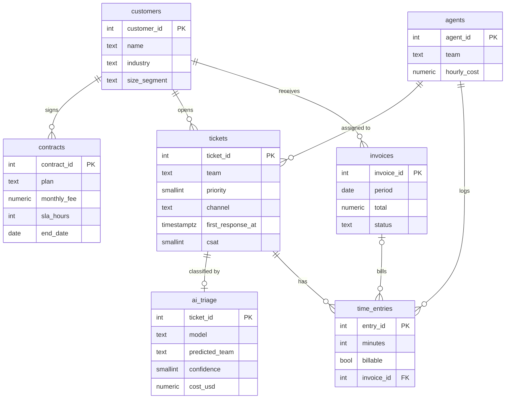

# Data layer

PostgreSQL 16 model of an **IT services company**: managed-services contracts, a helpdesk, AI ticket triage, time tracking and invoicing.

All data is **synthetic**, generated in pure SQL ([`seed/01_seed.sql`](seed/01_seed.sql)) with `generate_series` and a fixed `setseed()`. Dates are relative to `current_date`, so "last month" always has data.

## Model

Every table and column has a `COMMENT`. They document the model **for the AI agent**: its `describe_table` tool returns them, so the LLM knows, for example, that `contracts.end_date IS NULL` means active, or that `ai_triage` must be compared with `tickets.team` to measure accuracy.

## Stories in the data

The generator includes realistic patterns so the analysis has something to find:

| Pattern | Where it shows up |
|---|---|
| AI triage went live 12 months ago and the model was upgraded 4 months ago | [`06_ai_triage_quality`](analytics/06_ai_triage_quality.sql) |
| The AI voice agent went live 9 months ago and its share grows from 10% to ~40% | [`09_channel_mix`](analytics/09_channel_mix.sql) |
| Before churning, customers open more tickets and give lower CSAT | [`05_churn_risk`](analytics/05_churn_risk.sql) |
| ~7% of billable time is never invoiced | [`07_revenue_leakage`](analytics/07_revenue_leakage.sql) |
| Premium customers are served faster, but some high-priority tickets still breach SLA | [`01_sla_compliance`](analytics/01_sla_compliance.sql) |

## Analytics pack

| # | Business question | SQL techniques |
|---|---|---|
| 01 | [Are we meeting the contractual SLA?](analytics/01_sla_compliance.sql) | range join to the active contract, `FILTER` |
| 02 | [How fast do we answer, per team?](analytics/02_response_time_percentiles.sql) | `percentile_cont` (p50/p90/p99) |
| 03 | [What is in the backlog and how old is it?](analytics/03_backlog_aging.sql) | age buckets with `FILTER` |
| 04 | [How is recurring revenue evolving?](analytics/04_mrr_and_churn.sql) | `generate_series` calendar, `LAG` |
| 05 | [Which active customers are at risk of churning?](analytics/05_churn_risk.sql) | two-window comparison, risk score |
| 06 | [From which confidence can the AI triage route alone?](analytics/06_ai_triage_quality.sql) | cumulative window frames, `ROLLUP` |
| 07 | [How much billable work was never invoiced?](analytics/07_revenue_leakage.sql) | anti-join, running total |
| 08 | [Which customers are profitable?](analytics/08_customer_profitability.sql) | pre-aggregation to avoid fan-out, `NTILE` |
| 09 | [Is the voice agent taking load off the phone?](analytics/09_channel_mix.sql) | conditional-aggregation pivot, `LAG` |
| 10 | [Who owes us money and for how long?](analytics/10_receivables_aging.sql) | aging buckets, ordered `string_agg` |

Example: what query 06 answers.

| confidence_band | accuracy_pct | coverage_pct | accuracy_if_auto_pct |
|---|---|---|---|
| 90-99 | 94.8 | 35.1 | 94.8 |
| 80-89 | 86.2 | 63.1 | **91.0** |
| 70-79 | 78.8 | 82.7 | 88.1 |

→ Auto-routing tickets with confidence ≥ 80 covers **63%** of the volume at **91%** accuracy. The rest goes to a human.

## Security: the agent's database role

[`schema/02_agent_readonly_role.sql`](schema/02_agent_readonly_role.sql) creates `agent_readonly`:

- `SELECT` only, on the `ops` schema
- `default_transaction_read_only = on`
- `statement_timeout = 5s`
- no `CREATE` anywhere

The database enforces these rules even if the LLM produces a harmful query. Tests check them: [`tests/test_sql.py`](../tests/test_sql.py).
